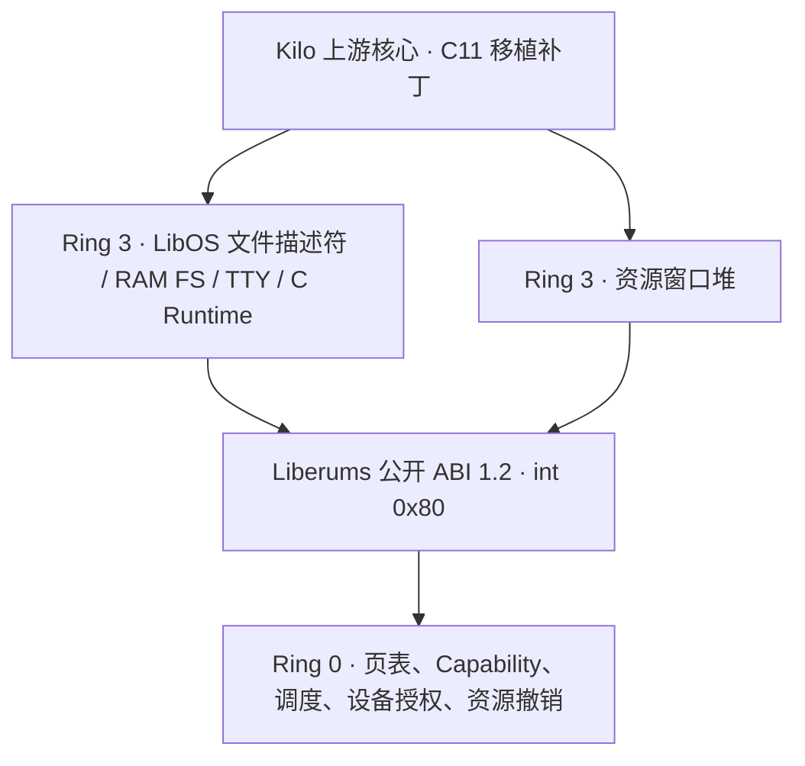

# 架构

`_start` 清方向标志并整理栈后进入 C。链接脚本将 RX、R 和 RW 段各自分页，注入 36 字节 ABI Note。运行时通过 SDK 的整数寄存器包装调用 ABI_QUERY，检查版本与所需 feature，再查询配额。退出走 SYS_EXIT 并由内核销毁域。COM1 只用于短诊断，文件描述符 1/2 在设备授权后走 VGA。

堆通过 PAGE_CLAIM 和 PAGE_MAP 获得连续虚拟地址，可使用物理不连续的四页。块头和分配对齐均为 16 字节，支持分割、合并、在邻接空闲块上扩容及复制迁移，记账统计的是活动申请字节。指针须精确匹配当前分配，内部指针或未复用的已释放指针会被拒绝。若该地址被再次分配，C 裸指针无法区分两代对象。堆打开失败时回滚已申请页，正常关闭执行 UNMAP / RELEASE。

分配、释放和等待输入都有撤销安全点。有待处理事件时，运行时通过 POLL/INFO/ACK 归还事件对应页并结束整个会话，其余资源由内核清理。ACK 前不依赖堆对象，也不进行编辑数据迁移。若 IRQ0 在两个访问之间已强制撤销，旧指针可能触发真实用户态缺页。用户态无 pin、缺页续跑、线程或取消抢占机制。

RAM 文件槽和名字由该域的 BSS 保存。描述符是 LibOS 整数索引，内核页、VGA 和键盘句柄保留各自的 capability 身份。相同虚拟地址可以由每个域的私有 CR3 映射到不同物理页。

Phase 2 增加静态应用选择器。Kilo、sbase `cat` 和内置文件信息共用域资源。应用私有临时对象由入口边界回收，RAM 文件则由 POSIX 层管理。 [应用生命周期](application-lifecycle.md)

Phase 3.1 使用单独的原生加载器 ELF。Liberums 按 ABI 1.2 加载它并进入 Ring 3。用户态解析器随后验证 Linux ET_EXEC，在原生 BSS 中构造客体映像、栈和寄存器。客体地址只通过软件权限检查访问缓冲区。当前执行器入口只取字节。 [客体内存](linux-guest-memory.md)
